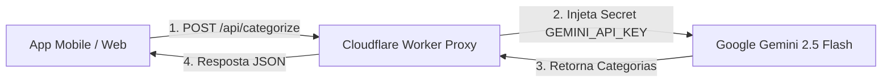

# 🚀 Melhoria Futura: Proxy Serverless Seguro para IA (Gemini Flash)

> **Status:** Backlog / Planejado  
> **Prioridade:** Média  
> **Arquitetura Atual:** BYOK (*Bring Your Own Key* no `localStorage` do cliente)  
> **Objetivo:** Permitir que qualquer usuário utilize a categorização por Inteligência Artificial sem precisar criar conta ou chave no Google AI Studio.

---

## 1. Contexto & Diagnóstico Atual

Atualmente, o aplicativo adota o modelo **BYOK (*Bring Your Own Key*)**:
- A chave do Google Gemini fica salva localmente no navegador / dispositivo do usuário (`localStorage`).
- **Pontos Positivos:** Custo zero para o mantenedor do app, privacidade local e conformidade com as diretrizes do Google (que proíbem expor chaves públicas no front-end).
- **Ponto de Fricção:** Exige que novos usuários que queiram usar IA criem uma conta no Google AI Studio e gerem uma chave de API manualmente nas configurações do app.

---

## 2. Solução Proposta: Proxy Serverless Gratuito

Criar um micro-serviço serverless gratuito intermediário (hospedado no **Cloudflare Workers** ou **Vercel Functions**):



### Principais Benefícios:
1. **Zero Setup para o Usuário Final:** O app já funciona com IA "out of the box".
2. **Chave 100% Protegida:** A chave mestra do Gemini fica armazenada nos segredos criptografados do Cloudflare/Vercel (`CLOUDFLARE_SECRETS`), sem jamais ser exposta no código client-side ou APK.
3. **Custo $0,00:**
   * **Cloudflare Workers:** 100.000 requisições gratuitas por dia.
   * **Google AI Studio:** Camada gratuita (Free Tier) do Gemini Flash.
4. **Abordagem Híbrida Inteligente:**
   * O app tenta primeiro o proxy serverless compartilhado.
   * Se o usuário tiver cadastrado uma chave própria nas configurações, ela tem prioridade (*override*).

---

## 3. Especificação Técnica da Implementação

### 3.1. Cloudflare Worker (`worker.js`)
Exemplo de implementação com validação de payload e rate limiting básico:

```javascript
export default {
  async fetch(request, env) {
    // 1. Tratar CORS
    if (request.method === "OPTIONS") {
      return new Response(null, {
        headers: {
          "Access-Control-Allow-Origin": "*",
          "Access-Control-Allow-Methods": "POST, OPTIONS",
          "Access-Control-Allow-Headers": "Content-Type"
        }
      });
    }

    if (request.method !== "POST") {
      return new Response("Método não permitido", { status: 405 });
    }

    try {
      const { items, categories } = await request.json();
      
      // Validação de tamanho para evitar abuso
      if (!Array.isArray(items) || items.length > 100) {
        return new Response(JSON.stringify({ error: "Máximo de 100 itens por lote" }), { status: 400 });
      }

      // 2. Chamar o Gemini usando o Secret do ambiente
      const geminiUrl = `https://generativelanguage.googleapis.com/v1beta/models/gemini-2.5-flash:generateContent?key=${env.GEMINI_API_KEY}`;
      
      const prompt = `Categorize as seguintes transações financeiras brasileiras nas categorias válidas: ${categories.map(c => c.name).join(', ')}...`;

      const response = await fetch(geminiUrl, {
        method: 'POST',
        headers: { 'Content-Type': 'application/json' },
        body: JSON.stringify({
          contents: [{ parts: [{ text: prompt }] }],
          generationConfig: { responseMimeType: "application/json" }
        })
      });

      const data = await response.json();
      return new Response(JSON.stringify(data), {
        headers: {
          "Content-Type": "application/json",
          "Access-Control-Allow-Origin": "*"
        }
      });

    } catch (err) {
      return new Response(JSON.stringify({ error: err.message }), { status: 500 });
    }
  }
};
```

### 3.2. Mecanismos de Proteção contra Abuso:
* **Rate Limiting:** Limite de 30 chamadas por IP / hora via Cloudflare WAF ou KV Cache.
* **Payload Limiter:** Limite máximo de transações por chamada (ex: 100 transações).
* **Restrição de Origem:** Permitir apenas requisições originadas do domínio do app e de apps Capacitor nativos (`capacitor://localhost`, `http://localhost`).

---

## 4. Checklist de Execução Futura

- [ ] Criar conta no Cloudflare (gratuita) ou Vercel.
- [ ] Configurar repositório ou rota `/api/categorize` no Cloudflare Worker.
- [ ] Adicionar o segredo `GEMINI_API_KEY` nas variáveis de ambiente do worker.
- [ ] Atualizar `src/utils/geminiCategorizer.js` para chamar o endpoint proxy como fallback caso o usuário não informe chave própria.
- [ ] Adicionar aviso amigável na tela de importação: *"Usando IA do servidor da comunidade (ou sua própria chave em Configurações)"*.
